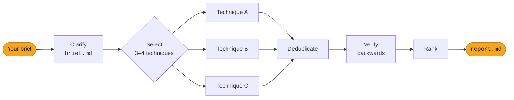

<div align="center">

<picture>
  <source media="(prefers-color-scheme: dark)" srcset="docs/assets/logo-dark.svg">
  
</picture>

**Lateral-thinking idea generation skills for any agent host that supports `SKILL.md` skills, with any model.**

Nine classic creativity techniques, each run in isolation, every idea verified backwards, one ranked shortlist.

[](#skills)
[](#techniques)
[](#install)
[](#install)
[](LICENSE)

[Install](#install) · [How it works](#how-a-session-runs) · [Skills](#skills) · [Sample output](#sample-output) · [Examples](#examples)

</div>

---

## Why Eureka

Ask a model for ideas and you get the obvious solution, reworded a few times. Eureka makes the agent think *sideways* on purpose:

- 🎲 **Real techniques, not "be creative".** Random Entry, Provocation (`PO`), SCAMPER, Six Hats, Challenge, Reversal, Concept Fan, Fractionation and Alternatives, each with its own procedure and stimulus.
- 🧪 **Isolated generation.** Each technique runs in its own sub-agent with a fresh context, so techniques never see each other's ideas. When two still land on the same idea, that convergence counts.
- 🔙 **Backward verification.** Every idea is assumed realised and walked back to today in at most 7 steps, without seeing how it was reached. Ideas that break your constraints never reach the shortlist.
- 📋 **A report you can act on.** A ranked shortlist of 5–10 ideas, each with its movement and a concrete first step, plus an appendix holding every other idea.
- 🌍 **Your language.** Every output follows the language of your brief.

## Install

```sh
npx skills add lupin72/eureka
```

Then give `eureka` a free-form brief in any language:

> Use eureka. Our neighbourhood library has lost half its visitors in two years. We want it full again on weekday afternoons. Budget is under €2,000, two staff, no building changes.

## How a session runs



1. **Clarify.** It maps the brief onto five fields (problem, desired state, current situation, constraints, out of bounds), asks in one message about only the fields you left out, and writes `brief.md` with the obvious solution added as a baseline. A brief that fills all five runs without a question.
2. **Select.** It picks 3–4 techniques whose strengths fit the brief and tells you which and why. Name techniques in the brief to choose them yourself, or add `--all` to run all nine. Techniques that are not installed are skipped and reported.
3. **Generate.** Each technique runs in its own sub-agent with a fresh context, so techniques never see each other's ideas, and writes 5–8 idea cards to its own file. On hosts without sub-agents the techniques run one after another, each written before the next starts.
4. **Deduplicate.** Near-identical cards from different techniques merge into one that keeps every source and is marked as converged. The other cards stay in their files, marked with the card they were merged into, and are left out of verification and ranking.
5. **Verify.** `lateral-verify` runs once per ideas file, in parallel, on a copy of the cards with the Movement removed, so it tests the idea rather than how it was reached. It assumes each idea is realised, walks back to today in at most 7 steps, and gives one verdict: ✅ adherent and walkable, 🔧 adherent with a link to fix, ❌ not adherent.
6. **Rank.** ❌ ideas go to the appendix; the rest are ordered ✅ before 🔧, then by distance from the obvious solution, then by convergence across techniques.
7. **Report.** It writes `report.md` (the techniques and why, a shortlist of 5–10 ideas each with its movement and a concrete first step, and an appendix holding every other idea with its technique and verdict) and prints a summary in chat. The only exception to the 5-idea minimum: when fewer than 5 ideas pass the adherence gate, the shortlist holds all of them.

Every output follows the language of your brief.

## Skills

All skills live under `skills/lateral-thinking/`.

### Orchestrator

| Skill | What it does |
| --- | --- |
| `eureka` | The entry point. Clarifies your brief, picks 3–4 techniques that suit it, runs each in its own sub-agent, verifies every idea backwards, and reports a ranked shortlist. |

### Techniques

| Skill | What it does |
| --- | --- |
| `lateral-random-entry` | Forces your problem to collide with a random word drawn from a bundled list of ~2000 concrete nouns, and turns the collision into 5–8 idea cards. |
| `lateral-provocation` | States deliberately unreasonable `PO` statements about your problem, of a type drawn at random (reversal, exaggeration, distortion, wishful thinking), and uses movement to turn them into 5–8 idea cards. |
| `lateral-scamper` | Runs what exists today through Substitute, Combine, Adapt, Modify, Put to another use, Eliminate and Reverse, and writes 5–8 idea cards, each naming its operator. |
| `lateral-six-hats` | Generates raw ideas with the Green Hat, reshapes each with White, Red, Black and Yellow (no verdicts), and writes 5–8 idea cards showing the seed and its refinement. |
| `lateral-challenge` | Asks "why is it done this way?" until the assumptions behind the current handling surface, then drops or replaces each one, giving 5–8 idea cards that each name the assumption challenged. |
| `lateral-reversal` | Reverses the problem's directions (who acts on whom, what flows where, what comes first), then moves from each reversed form to 5–8 idea cards that each name the reversal applied. |
| `lateral-concept-fan` | Steps back from your goal to broad directions, then concepts, then concrete ideas, and cards each idea with the concept it came from. |
| `lateral-fractionation` | Breaks your situation into fragments and recombines them in new ways, carding each idea with the fractions it joins. |
| `lateral-alternatives` | Takes each element of the obvious solution and pushes for alternatives past the first adequate ones, carding each idea with its element and alternative. |

### Verifier

| Skill | What it does |
| --- | --- |
| `lateral-verify` | Tests ideas backwards: assumes each is realised, walks back to today in at most 7 steps, and gives each one verdict: ✅ adherent and walkable, 🔧 adherent with a link to fix, ❌ not adherent. |

## Sample output

The top of the shortlist from the [Pantry reference session](examples/reference/2026-11-05-pantry-new-user-retention/report.md), a meal-planning app losing 40% of new users within three weeks:

> ### 1. Basket-first week
>
> **Source:** Challenge, Provocation (converged)\
> **Verdict:** ✅ Adherent and walkable\
> **Why it ranks here:** ✅ and the furthest from the baseline: it reverses the order of planning and shopping instead of coaching users through the existing order; reached by Challenge and Provocation.\
> **First step:** Ask 15 users who stopped after week two to photograph their next supermarket receipt, and hand-build a week of dinners from each to see how many they would cook.

## Session folder

Every session lives in a dated folder in your project. A full `eureka` session writes:

```
eureka/<YYYY-MM-DD>-<slug>/
├── brief.md                    # the five fields plus the obvious-solution baseline
├── ideas/
│   └── <technique>.md          # 5–8 idea cards per technique; duplicates marked, never removed
├── verification/
│   ├── <technique>.input.md    # the live cards as the verifier saw them, Movement removed
│   └── <technique>.md          # that file's backward chains and verdicts
├── verification.md             # all verification sections, assembled
└── report.md                   # techniques, ranked shortlist, appendix
```

Each idea card has a title, a description, the technique and its stimulus (a random word, a `PO` statement, a challenged assumption, …), the movement from stimulus to idea, and the problem it solves.

A standalone technique run writes only `brief.md` and `ideas/`; a standalone verifier run adds `verification/` and `verification.md`.

## Using a skill on its own

<details>
<summary><b>A single technique</b>: a quick, focused session</summary>

<br>

Invoke a technique skill with a free-form brief for a quick focused session, for example:

> Use lateral-random-entry. Our neighbourhood library has lost half its visitors in two years. We want it full again on weekday afternoons. Budget is under €2,000, two staff, no building changes.

It clarifies the brief the same way, writes its ideas file, then offers to run `lateral-verify` on the session; it never runs it on its own.

</details>

<details>
<summary><b>Verifying ideas</b>: re-check a session, or test your own list</summary>

<br>

Point `lateral-verify` at a session folder to (re-)verify every ideas file in it, for example after tightening the constraints in `brief.md`. Or give it your own list of ideas plus a brief: it creates a session folder, records your ideas in `ideas/own.md`, and verifies them. Either way it writes the stripped inputs and one section per ideas file under `verification/`, assembles them into `verification.md`, and never removes an idea. An existing `report.md` is then stale: ask `eureka` to rank and report that session again.

</details>

## Examples

`examples/` holds three briefs from different domains and, under `examples/reference/`, the session each produced, including one `--all` run. Run `eureka` on a brief and compare your session with its reference.

| Brief | Domain | Reference session | Techniques |
| --- | --- | --- | --- |
| [Product](examples/product-brief.md) | Meal-planning app retention | [pantry-new-user-retention](examples/reference/2026-11-05-pantry-new-user-retention/report.md) | SCAMPER, Challenge, Provocation, Random Entry |
| [Non-profit](examples/non-profit-brief.md) | Food bank volunteers | [food-bank-volunteer-renewal](examples/reference/2026-11-05-food-bank-volunteer-renewal/report.md) | Reversal, Fractionation, Six Hats |
| [Non-profit](examples/non-profit-brief.md) with `--all` | Food bank volunteers | [second-shelf-volunteer-rota](examples/reference/2026-11-05-second-shelf-volunteer-rota/report.md) | All nine |
| [Personal](examples/personal-brief.md) (Italian) | Making new friends | [nuove-amicizie-torino](examples/reference/2026-11-05-nuove-amicizie-torino/report.md) | Concept Fan, Alternatives, Random Entry |

## License

[MIT](LICENSE) © 2026 Pierpaolo Gorelli

<div align="center">
<br>
<sub>Built for agents that think sideways.</sub>
</div>
